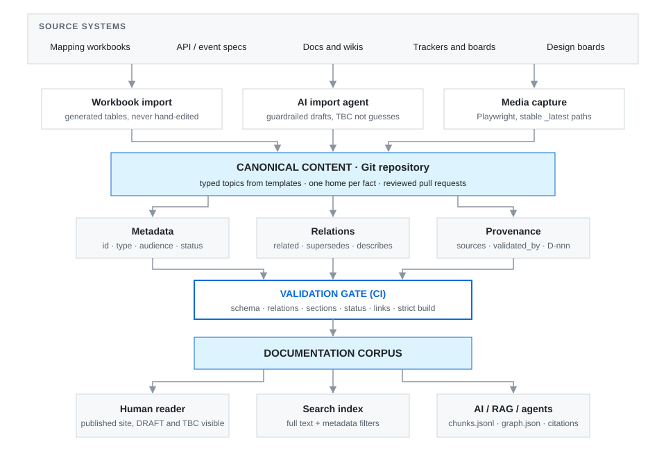

# AI-Native Documentation Architecture

**A proof-of-concept documentation system designed for the intersection of technical documentation, structured content, AI-assisted authoring, and retrieval-augmented generation (RAG).**

This project explores one question:

> What does documentation look like when it must be consumed equally well by humans, search systems, LLMs, and AI agents?

Rather than treating documentation as a collection of pages, this architecture treats it as a **structured knowledge system**: every topic has a type, a stable identity, machine-readable metadata, explicit relationships, and a traceable source. The same corpus renders as a website for people and exports as metadata-rich chunks and a relationship graph for retrieval.

| If you have… | Read |
|---|---|
| 30 seconds | This page, down to [Why this matters](#why-this-matters) |
| 5 minutes | [Architecture overview](architecture/overview.md) and one [example topic](examples/procedure.md) |
| 20 minutes | The full [architecture](architecture/), the [tooling](tooling/README.md), and the [validation rules](validation/README.md) |
| An interview slot | The [walkthrough](WALKTHROUGH.md): a 15-minute live demo of this repository |

## What this demonstrates

- AI-ready documentation architecture
- Structured content and semantic metadata
- Documentation taxonomy and information architecture
- Machine-readable content relationships
- Provenance and canonical-source concepts
- RAG-oriented content design (chunking, metadata inheritance, citation targets)
- AI-assisted documentation workflows with human review gates
- Automated documentation tooling (validation, media capture, retrieval export)
- Content validation and quality controls in CI
- Human-readable and machine-readable representations of the same content
- Developer and end-user documentation within one content model
- SDK documentation as tested code: a [Python SDK quickstart](examples/sdk-quickstart-python.md) whose every code block is a CI-tested sample, with a drift check and an AI review skill

## Architecture



```text
                SOURCE SYSTEMS
   (workbooks · docs · wikis · trackers · design boards)
                      │
                      ▼
             CANONICAL CONTENT            ← one owner, one location per fact
                      │
                      ▼
            STRUCTURED CONTENT MODEL      ← typed topics from templates
                      │
          ┌───────────┼───────────┐
          ▼           ▼           ▼
       Metadata    Relations    Provenance
          │           │           │
          └───────────┼───────────┘
                      ▼
          VALIDATION GATE (CI)            ← schema · links · status rules
                      │
                      ▼
              DOCUMENTATION CORPUS
                      │
          ┌───────────┼───────────┐
          ▼           ▼           ▼
        Human       Search      AI / RAG
        reader      index       / agents
```

Each layer is documented in [`architecture/`](architecture/):

| Layer | Document |
|---|---|
| The system end to end | [Overview](architecture/overview.md) |
| Topic types and how they relate | [Content model](architecture/content-model.md) |
| Frontmatter fields, IDs, and controlled vocabularies | [Metadata model](architecture/metadata-model.md) |
| Chunking, metadata inheritance, graph export, citations | [Retrieval model](architecture/retrieval-model.md) |
| Canonical sources, status, decision records | [Provenance](architecture/provenance.md) |
| How AI fits into authoring without owning the truth | [AI-assisted workflow](architecture/ai-workflow.md) |

## Why this matters

Traditional documentation is optimized for human reading. AI systems add requirements:

- content needs **predictable structure**
- concepts need **explicit semantic relationships**
- **source authority** needs to be identifiable
- content needs **machine-readable metadata**
- procedures need to expose their **intent and context**
- visuals need **semantic association**, not just a filename
- API concepts need **relationships to business concepts**
- changes need to be **traceable and validated**

This POC treats each of those as a first-class documentation concern, enforced by tooling rather than by good intentions.

## Example

A conventional documentation system associates an image with a filename:

```text
image_001.png
```

An AI-ready system associates the visual with explicit semantic context. This is the real frontmatter of [`examples/training.md`](examples/training.md):

```yaml
id: training.rental.modify
type: training
domain: rental
audience:
  - branch-staff
  - trainer
visual:
  type: diagram
  asset: assets/modify-rental-flow.svg
  describes: procedure.rental.modify
  alt: "Five-step flow for changing the dates or items on an open rental agreement"
related:
  - procedure.rental.modify
  - api.rental.update
  - event.rental.updated
```

The visual is no longer simply an image. It is part of the knowledge model: a retriever that finds the procedure can also find the visual that explains it, the API that implements it, and the event it emits.

## Try it

The examples in this repository are a small, valid corpus. The validator enforces the metadata schema and the relationship rules, then exports the retrieval artifacts.

```bash
python -m venv .venv
# Windows: .venv\Scripts\activate    macOS/Linux: source .venv/bin/activate
pip install -r tooling/requirements.txt
python tooling/validate_corpus.py examples --export build
```

Output:

- `build/chunks.jsonl`: one retrieval chunk per section, each carrying its topic's metadata and a citation anchor
- `build/graph.json`: topics as nodes, `related` / `supersedes` / `describes` as typed edges

CI runs the same command on every pull request. See [validation](validation/README.md).

### The SDK quickstart

The [Python SDK quickstart](examples/sdk-quickstart-python.md) runs against a local mock of the Waypoint API, so you need no account:

```bash
pip install ./sdk/python pytest
python tooling/check_snippets.py examples      # code blocks match their samples
python -m pytest sdk/python/tests tooling/tests  # samples run; documented output is real
```

See [`sdk/`](sdk/README.md) for how the SDK, the mock, the samples, and the page fit together.

## Repository map

```text
.
├── README.md                 # you are here
├── WALKTHROUGH.md            # what I demonstrate live in an interview
├── architecture/             # the design: content, metadata, retrieval, provenance, AI workflow
├── examples/                 # a small valid corpus in a fictional domain
├── templates/                # topic templates authors start from
├── schemas/                  # JSON Schema for topic frontmatter
├── governance/               # style guide and status rules
├── agents/                   # AI import-agent definition (guardrails as configuration)
├── .claude/skills/           # AI review skill for SDK and API docs
├── sdk/                      # Python SDK, local mock API, and the tested samples the quickstart shows
├── tooling/                  # validator, snippet drift check, retrieval export; the wider toolkit
├── validation/               # every rule the gate enforces, and why
├── diagrams/                 # architecture diagrams (SVG)
└── .github/workflows/        # CI: validate the corpus, check snippets, run the samples on every PR
```

## Technology and tooling

- Git and GitHub (branch, pull request, review, protected main)
- Markdown with YAML frontmatter
- JSON Schema for metadata contracts
- Python for validation and retrieval export
- MkDocs Material with strict builds, deployed to GitHub Pages (private implementation)
- Playwright for automated capture of design boards and UI screenshots (private implementation)
- GitHub Actions for CI/CD
- Claude Code and agent definitions for AI-assisted authoring, with MCP-oriented tooling
- Claude Code skills as editorial checks ([`review-sdk-docs`](.claude/skills/review-sdk-docs/SKILL.md))
- pytest for SDK tests and executable code samples
- Mermaid and SVG for diffable diagrams

## Project status

This is an evolving proof of concept exploring practical approaches to AI-native documentation engineering.

The **production POC** runs in a private repository because its content is proprietary. Everything here is a sanitized, clean-room presentation of the architecture. The examples use a **fictional equipment-rental company** and contain no client material. The [overview](architecture/overview.md#what-is-implemented-where) states which parts run in the private implementation and which are demonstrated here.

Production implementations differ with the source systems, governance requirements, retrieval architecture, and AI platform involved.

## About

Designed and implemented by **Shawn Dale**, principal-level technical documentation professional specializing in documentation architecture, developer experience, APIs, AI-assisted documentation, and structured knowledge systems.

> I don't just document AI systems. I design documentation systems that AI systems can understand.

The production POC is maintained in a private repository. I'm happy to walk through the architecture and demonstrate it live in an interview.
