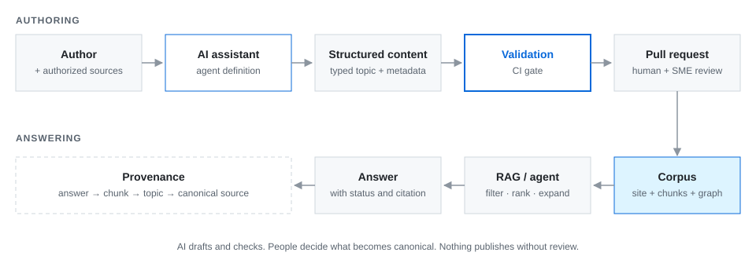

# AI-assisted workflow

AI speeds up the parts of documentation work that are mechanical: reading source material, restructuring it into templates, checking consistency, and running the build. It doesn't decide what's true. This document describes where AI sits in the workflow and the guardrails that keep it there.

## The workflow



```text
Author + source material
        │
        ▼
AI assistant (Claude Code + agent definition)
        │   inventories sources, classifies by topic type,
        │   drafts from templates, flags contradictions as TBC
        ▼
Structured content (typed topics + frontmatter)
        │
        ▼
Validation (schema, links, status rules, strict build)
        │
        ▼
Git pull request ── human review and SME sign-off
        │
        ▼
Documentation corpus
        │
        ▼
RAG / agent ── answer
        │
        ▼
Provenance ── chunk → topic → canonical source
```

## Where AI helps, and where it's not allowed

| Step | AI role | Human role |
|---|---|---|
| Source intake | Inventory each source: system, location, version, audience, gaps | Provide authorized exports or access; decide scope |
| Classification | Propose a topic type for each piece of content | Confirm when ambiguous |
| Drafting | Restructure into the matching template, keep terminology consistent | Supply missing facts |
| Consistency | Compare overlapping claims; report contradictions with sources and dates | **Decide** which source is authoritative |
| Metadata | Fill frontmatter, propose `related` links | Confirm relationships that carry meaning |
| Verification | Run the validator and the strict build; inspect the rendered page | Review the pull request |
| Publishing | **Not allowed** | Approve and merge |

## Guardrails as configuration

The guardrails aren't a policy document that people may or may not read. They're written into the **agent definition** the assistant loads, so they apply on every run. The full definition is in [`agents/documentation-import.agent.md`](../agents/documentation-import.agent.md). The core constraints:

- **Work only from authorized material.** Never imply access to a system without a working, authorized connector. Never ask for credentials in chat.
- **Preserve meaning; separate fact from interpretation.** Never invent missing details. Never silently resolve conflicting claims.
- **Preserve provenance.** Record source system, title or link, file or sheet, version, and date.
- **Mark uncertainty.** `TBC` for unconfirmed facts; `draft` status for unvalidated topics.
- **Don't fabricate visuals.** Reuse supplied media; never generate diagrams or screenshots that assert facts absent from the source.
- **Don't publish.** No commit, push, or merge unless a person explicitly authorizes that action.
- **Report honestly.** Distinguish "the build passed" from "the content is approved".

## Required report format

Every import ends with the same four sections, so a reviewer can check the work quickly:

| Section | Contents |
|---|---|
| **Sources** | Inventory with provenance |
| **Documentation changes** | Files changed and the transformations made |
| **Accuracy and open questions** | Contradictions, `TBC` items, what needs SME review |
| **Verification** | Validator and build results; whether visual inspection was done |

## Why the human review gate stays

An LLM is good at restructuring and poor at knowing which of two plausible sources is the current one. The architecture puts the model where it's strong and keeps a person at the one step where being wrong is expensive: deciding what becomes canonical.

The gate also protects the downstream AI. A RAG system is only as reliable as its corpus. If drafting assistants could publish directly, the retrieval layer would end up answering from content no person ever checked.

## Other agentic tooling in the workflow

| Tool | Use |
|---|---|
| Claude Code | Repository-aware drafting, refactoring of templates and navigation, running the validator and build, preparing pull requests |
| Agent definitions (`*.agent.md`) | Reusable, reviewable instructions scoped to one job, versioned in the repository like code |
| MCP connectors | Read-only access to source systems (documents, design boards, trackers) where an authorized connector exists |
| Playwright | Deterministic capture of design boards and UI screens, so visuals are regenerated rather than redrawn |
| Skills | Packaged, repeatable workflows, such as turning raw project material into a structured presentation brief and then a slide deck |
