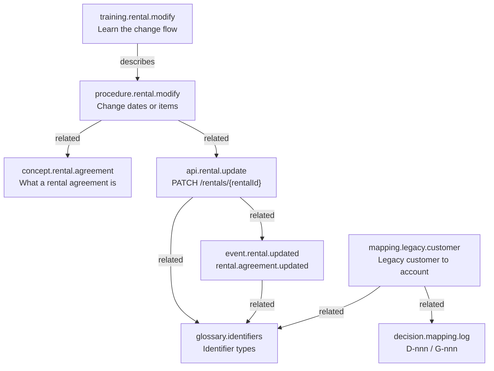

# Content model

The content model defines **what kinds of topic exist**, what each one must contain, and how topics connect. It's the contract between authors, reviewers, the site, and any machine that reads the corpus.

## Topic types

Every topic declares exactly one type. One topic answers one kind of question. Mixing types on a page is the most common reason documentation is hard to retrieve: a chunk that's half concept and half procedure matches every query a little and none of them well.

| Type | Answers | Required sections | Template |
|---|---|---|---|
| `concept` | What is it? How does it work? | How it works · Key objects and identifiers · Related topics | [concept](../templates/concept.md) |
| `procedure` | How do I do X? | Before you begin · Steps · Result · Related topics | [task](../templates/task.md) |
| `reference` | What are the exact values? | One table per lookup · Related topics | [reference](../templates/reference.md) |
| `api` | How do I call it, and what do the IDs mean? | Request · Response · Identifiers · Side effects · Errors | [example](../examples/api.md) |
| `event` | What happened, who emits it, and what's in it? | Trigger · Payload · Identifiers · Consumers · Ordering and idempotency | [example](../examples/event.md) |
| `training` | How do I learn to do X? | Learning objective · Walkthrough · Check your understanding | [example](../examples/training.md) |
| `mapping` | Where does legacy data X end up in the new system? | Summary · Relationship · Field mapping · Transformation rules · Code lookups · Identifiers · Gaps and decisions | [mapping](../templates/mapping.md) |
| `decision` | What was decided, by whom, and why? | Numbered entries: Context · Decision · Consequences | [example](../examples/decision-log.md) |
| `glossary` | Which term means what, exactly? | Definitions table · Rules | [example](../examples/glossary.md) |
| `quickstart` | How do I make my first working calls with the SDK? | Before you begin · Install the SDK · Check your setup · Make your first call · Handle errors | [example](../examples/sdk-quickstart-python.md) |

The type is in the frontmatter **and** the ID prefix (`procedure.rental.modify`). The validator rejects a mismatch.

## How types relate

Types aren't isolated. A business capability is usually documented as a cluster of topics, one per type, joined by declared relationships.



This is what makes the corpus useful to an agent. A question like *"what happens downstream when staff extend a rental?"* starts at the procedure, follows `related` to the API, and from there to the event and its consumers, without the agent having to guess which pages are connected.

## Business capability, not org chart

Topics are organized by **domain** (`rental`, `customer`, `fleet`, `billing`), not by which team wrote them. Teams reorganize; the business capability a reader is asking about doesn't. The domain is a controlled vocabulary in the [metadata model](metadata-model.md#controlled-vocabularies).

## Developer and end-user content in one model

A procedure for branch staff and an API reference for developers describe the **same business operation** from two sides. Keeping both in one model, joined by `related`, gives:

- developers the business meaning of the endpoint they're calling
- support and training teams the technical consequence of a UI action
- an AI assistant both views, filtered by `audience` at query time

The `audience` field decides who sees what. The relationship guarantees the two views never drift into describing different things.

## Identifier semantics are part of the content model

Integration documentation lives or dies on identifier precision. The content model requires every topic that mentions an identifier to state:

| Property | Question it answers |
|---|---|
| Owning system | Who issued it? |
| Identifier type | Internal ID, external reference, locator, or correlation ID? |
| Business-object scope | Which kind of record does it identify? |
| Relationship | One-to-one or one-to-many, and which side owns the link? |

"The ID" without those four properties is a defect. The [identifier glossary](../examples/glossary.md) defines the four types, and the [style guide](../governance/style-guide.md#identifiers-and-relationships) makes them mandatory.

## Topic anatomy

Every topic file has the same three parts:

```text
---
<frontmatter: machine-readable metadata, validated against the schema>
---
# <Title, matching frontmatter title>

<Summary paragraph: one or two sentences; also the retrieval abstract>

## <Section required by the topic type>
...
## Related topics
```

- **Frontmatter** is for machines and the gate.
- **The first paragraph** is for people skimming and for retrievers ranking.
- **H2 sections** are the chunk boundaries for retrieval. See [retrieval model](retrieval-model.md#chunking).
