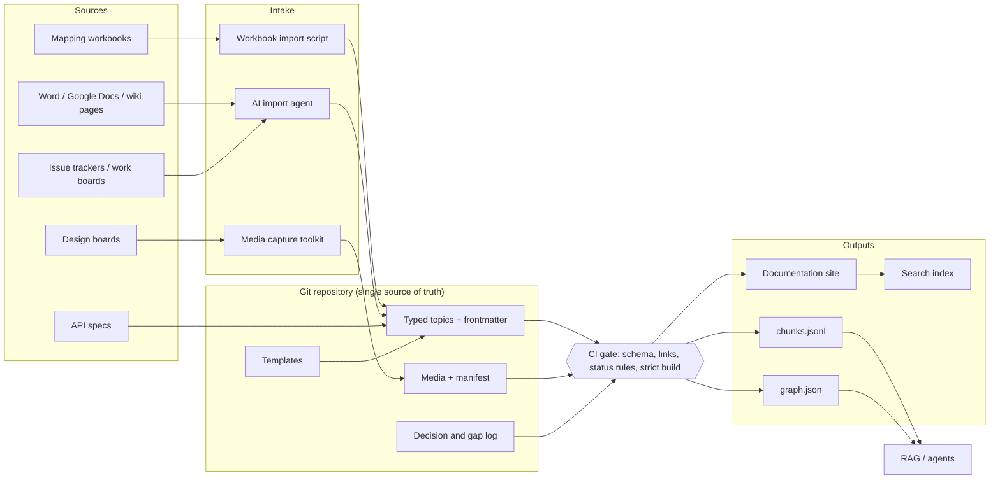
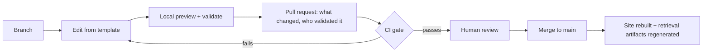

# Architecture overview

This document describes the system end to end: where content comes from, how it becomes structured knowledge, what checks it passes, and who (or what) consumes it.

## Design principles

1. **One canonical home per fact.** A fact lives in exactly one topic. Everything else links to it. Duplicated facts drift, and a retriever that finds two versions of a fact can't tell which one is right.
2. **Type before content.** Every topic has a declared type (concept, procedure, reference, API, event, training, mapping, decision). The type fixes its structure, so both readers and parsers know where to find things.
3. **Identity is stable, location is not.** Topics are addressed by a dotted ID (`procedure.rental.modify`), not by file path. Files can move; IDs never change and are never reused.
4. **Relationships are data.** "See also" prose is invisible to machines. Relationships are declared in metadata, validated, and exported as a graph.
5. **Uncertainty is marked, not hidden.** Unconfirmed facts carry `TBC`. Unvalidated topics carry `status: draft`. A validated topic can't contain `TBC`, and the gate enforces it.
6. **Provenance travels with content.** Every topic records where its facts came from, at what version, and who validated them. Retrieval chunks inherit that record, so an AI answer can cite a canonical source.
7. **AI drafts; people decide.** AI assistants import, structure, and check. They don't publish, resolve contradictions, or invent missing facts. See [AI-assisted workflow](ai-workflow.md).
8. **Everything is diffable.** Markdown, YAML, JSON, Mermaid, and SVG. If a reviewer can't see the change in a pull request, it doesn't belong in the corpus.

## System context

## Layers

| Layer | Responsibility | Where it's defined |
|---|---|---|
| Sources | Systems where knowledge originates. Never edited by the docs system. | — |
| Intake | Repeatable, reviewable conversion from a source into the repository. | [Tooling](../tooling/README.md), [import agent](../agents/documentation-import.agent.md) |
| Content model | Topic types, their sections, and how they relate. | [Content model](content-model.md), [templates](../templates/) |
| Metadata model | Frontmatter fields, ID grammar, controlled vocabularies. | [Metadata model](metadata-model.md), [schema](../schemas/topic.schema.json) |
| Provenance | Source, version, validation, and decision records. | [Provenance](provenance.md) |
| Validation gate | Machine-checked rules that block a merge. | [Validation](../validation/README.md) |
| Outputs | Site for humans; chunks and graph for machines. | [Retrieval model](retrieval-model.md) |

## The change lifecycle

No change reaches a reader, human or machine, without an author, a reviewer, and a passed gate.

The pull request is the audit record: what changed, who approved it, which checks passed, and when.

## What is implemented where

I am explicit about this so the portfolio never overclaims.

| Capability | Private production POC | This repository |
|---|---|---|
| Docs-as-code repository, branch and PR workflow | Running | Described |
| Typed templates (concept, task, reference, mapping) | Running | [Included](../templates/), generalized |
| Style guide with identifier and relationship rules | Running | [Included](../governance/style-guide.md), generalized |
| Status markers (`DRAFT`, `TBC`) and page/field status vocabularies | Running | Included, enforced by the validator |
| Numbered decision and gap log (`D-nnn`, `G-nnn`) | Running | [Example](../examples/decision-log.md) |
| Strict site build in CI and automatic deploy to GitHub Pages | Running | Described |
| AI import agent with fidelity and provenance guardrails | Running | [Included](../agents/documentation-import.agent.md), generalized |
| Media capture toolkit (Playwright) with stable paths and a manifest | Running | [Described](../tooling/README.md#media-capture-toolkit) |
| Presentation build from a structured brief (python-pptx) | Running | [Described](../tooling/README.md#presentation-as-code) |
| Workbook-to-table generation for field mappings | Designed, awaiting stable source layout | [Described](../tooling/README.md#workbook-import) |
| Repository-wide frontmatter schema with typed relationships | Designed | [Implemented](../schemas/topic.schema.json) |
| Validator and retrieval export (chunks + graph) | Designed | [Implemented](../tooling/validate_corpus.py) |

The last two rows are the next step for the production system. They're implemented here first, on a fictional corpus, so the design is proven before it's proposed for real content.
