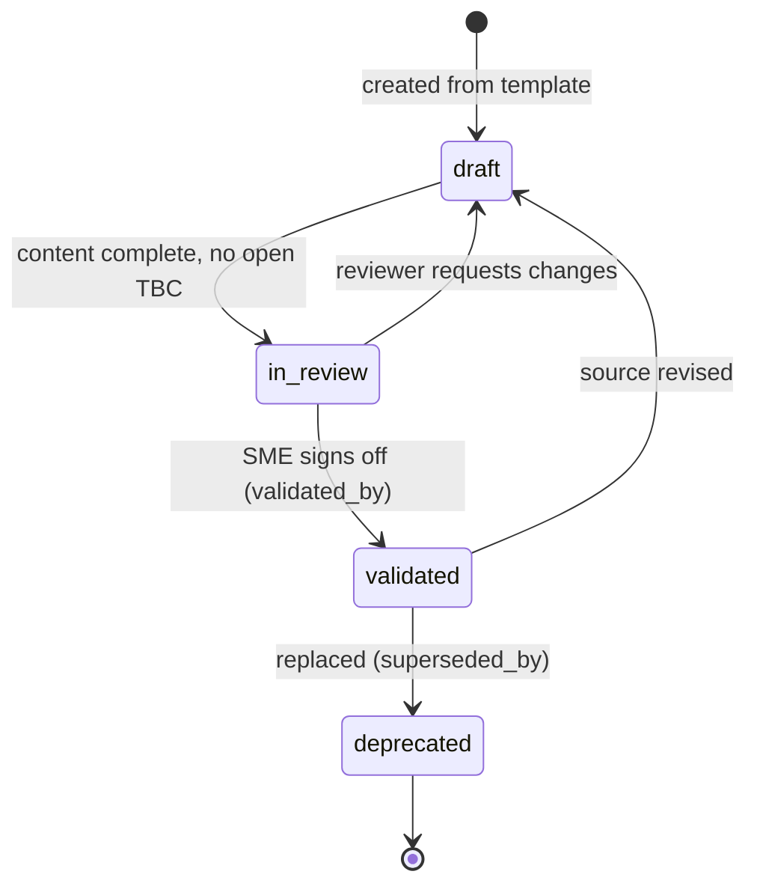

# Provenance

Provenance answers three questions about any statement in the corpus: **Where did it come from? Who confirmed it? Is it still the current answer?** For human readers that's a trust signal. For an AI system it's the difference between a grounded answer and a confident guess.

## Canonical sources

A **canonical source** is the one place where a fact is authoritative. The architecture distinguishes two layers:

| Layer | Examples | Rule |
|---|---|---|
| System of record | Product specs, API specs, mapping workbooks, configuration exports | The docs system **reads** these; it never edits them. When they change, the topics that cite them are updated. |
| Canonical topic | The one topic that owns a fact in the corpus | Every other topic **links** to it instead of restating it. `canonical: true` in frontmatter. |

Derived topics, such as a training module that walks through a procedure, set `canonical: false` and link the canonical topic with `related` or `visual.describes`. A retriever that finds both prefers the canonical one.

### When the source and the docs could both be edited

Some facts have two plausible homes. Field-level mapping rows are the classic case: they live in a workbook *and* need to appear in documentation. If both are edited by hand, they drift.

The rule used here is recorded as a decision (see [D-001 in the example log](../examples/decision-log.md#d-001-source-of-truth-for-field-level-mappings)):

- The **workbook stays authoritative** for field-level rows.
- The **mapping tables in the docs are generated** from the workbook by a script and never edited by hand.
- **Narrative, transformation rules, gaps, and decisions** are written by people around the generated tables.

That split is a general pattern: generate what has a structured system of record; hand-write what needs judgment.

## Source records

Every topic carries at least one `source` entry:

```yaml
source:
  - system: workbook
    title: Customer migration mapping
    ref: customer-mapping.xlsx, sheet "Accounts"
    version: "v4, 2026-09-12"
    retrieved: 2026-09-15
```

| Field | Why |
|---|---|
| `system` | What kind of source it is, for filtering and for knowing who to ask. |
| `title` | Human-readable name. |
| `ref` | Precise locator: document key, file and sheet, URL, or ticket ID. |
| `version` | Which revision the topic was written from. When the source is revised, this is how stale topics are found. |
| `retrieved` | When it was read. |

## Status lifecycle



| Status | Meaning | Enforced by the gate |
|---|---|---|
| `draft` | Structure in place; facts not yet confirmed. | Must show a visible `DRAFT` notice. `TBC` allowed. |
| `in-review` | Content complete; waiting for subject-matter sign-off. | No `TBC` allowed. |
| `validated` | A named role has confirmed it against its sources. | Requires `validated_by`. No `TBC`, no `DRAFT` notice. |
| `deprecated` | Replaced; kept so old links and citations still resolve. | Requires `superseded_by` pointing to a real topic. |

### `TBC`: uncertainty at the level of a single fact

A topic can be mostly right with one fact unconfirmed. `TBC` marks exactly that fact, inline or in a table cell, so the rest of the topic remains usable. The rule is simple: you can't validate a topic that still says `TBC`. The marker is removed in the same pull request that confirms the fact.

For an AI consumer, `TBC` is a signal to hedge, not to fill in. The [import agent](../agents/documentation-import.agent.md) is instructed to write `TBC` rather than infer a missing value.

## Decision and gap records

Decisions are provenance for **why** the content says what it says. They're kept in a numbered log rather than scattered through topics:

- `D-nnn` for decisions, `G-nnn` for gaps (something the target system can't represent).
- Numbers are **never reused or renumbered**, so a link to `D-004` means the same thing forever.
- Resolved gaps aren't deleted. They're marked **Resolved** and linked to the decision that resolved them.
- Topics link to entries (`[D-004](decision-log.md#d-004)`) instead of repeating the reasoning, so each decision is explained once.

Each entry records **Status · Date · Decided by · Affects**, then **Context · Decision · Consequences** (or **Impact · Options** for a gap). See the [example decision log](../examples/decision-log.md).

The result: "why wasn't this field migrated?" has a written answer, with a name and a date, that both a person and an agent can find.

## Contradictions between sources

When two sources disagree, the system **doesn't pick a winner silently**. The rule, for both writers and the AI agent:

1. Record both claims with their sources and dates.
2. Mark the fact `TBC` in the topic.
3. Raise it with the designated owner, or log it as an open question.
4. Resolve it with a decision record if the answer isn't obvious from authority alone.

## The audit trail is Git

Every change to a topic is a commit in a reviewed pull request, so the repository itself answers *who changed this, when, why, and who approved it*, with no extra effort from authors.
