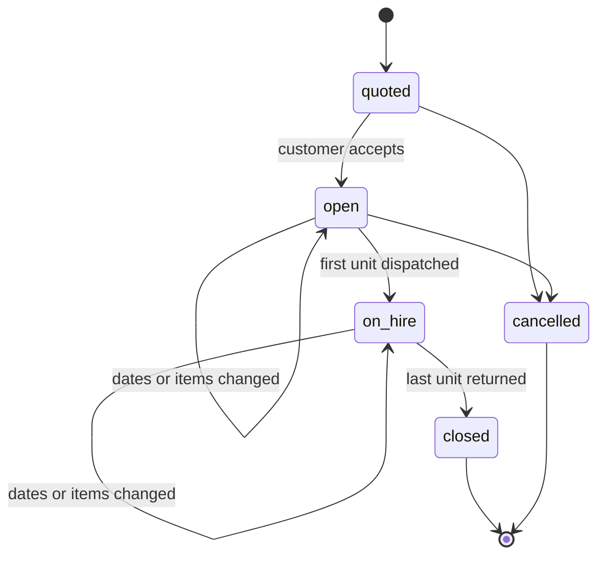

# What a rental agreement is

A **rental agreement** is the contract between Fieldline and a customer for one or more fleet units over a period. It owns the rental dates, the list of items, and the agreed price. Everything else in the rental flow (deliveries, invoices, damage reports) hangs off an agreement.

## How it works

An agreement moves through a fixed set of states. Only **open** agreements can be changed by branch staff; a **closed** agreement can only be corrected by an adjustment on its invoice.

Each change to dates or items creates a new **revision** of the agreement. The revision number increases by one; earlier revisions are kept for billing and audit.

## Key objects and identifiers

| Object | Owning system | Identifier | Identifier type |
|---|---|---|---|
| Rental agreement | Waypoint | `rentalId` (UUID) | Internal ID |
| Rental agreement | Waypoint | Agreement number, for example `FL-2026-004211` | Locator |
| Rental agreement | Classic (legacy) | Classic contract number, stored on the agreement | External reference (source system `classic`) |
| Agreement line | Waypoint | `lineId` (UUID), scoped to one agreement | Internal ID |
| Fleet unit | Waypoint fleet service | `unitId` | Internal ID |

The agreement number is what customers and staff quote. It's a locator, not a key: integrations address the agreement by `rentalId`. See the [identifier glossary](glossary.md).

One agreement has one or more lines. Each line references exactly one fleet unit for a date range; a fleet unit can appear on many agreements over time, but on only one open line for any given date.

## Related topics

- [Change the dates or items on a rental agreement](procedure.md)
- [Update a rental agreement (API)](api.md)
- [Identifier glossary](glossary.md)
