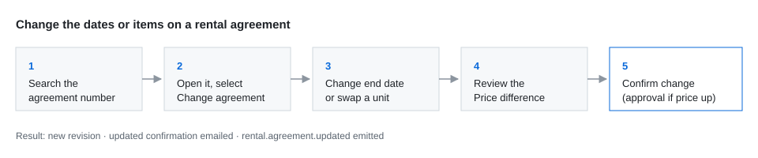

# Learn to change a rental agreement

A ten-minute module for new branch staff. It teaches the change flow and how to explain the price difference to a customer. The steps themselves are owned by the [procedure](procedure.md); this module links to it rather than restating it, so the two can't drift apart.

## Learning objective

By the end of this module you can:

- tell whether an agreement can be changed, from its state
- change the end date or swap a unit on an open agreement
- read the **Price difference** panel and explain it to the customer

## Walkthrough

1. Follow the steps in [Change the dates or items on a rental agreement](procedure.md#steps) on the training environment, using agreement `FL-TRAIN-000101`.
2. Extend the end date by two days. Note the price difference.
3. Swap the excavator on line 1 for the smaller model. Note how the difference changes.
4. Cancel without confirming.

## Check your understanding

| Question | Answer |
|---|---|
| A customer wants to shorten an agreement that's already **closed**. Can you use this flow? | No. A closed agreement is corrected by an invoice adjustment. |
| Where do you see what the customer will be charged? | The **Price difference** panel, before you confirm. |
| What happens to the earlier version of the agreement? | It's kept as an earlier revision, for billing and audit. |

## Related topics

- [Change the dates or items on a rental agreement](procedure.md)
- [Update a rental agreement (API)](api.md)
