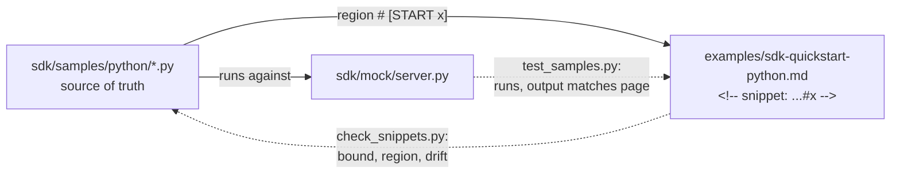

# SDK and samples

A small Python SDK for the fictional Waypoint Rentals API, a local mock of that API, and the samples the [Python SDK quickstart](../examples/sdk-quickstart-python.md) shows. It exists to demonstrate one practice: **code in developer docs is tested code**.

```text
sdk/
├── python/              # the SDK package (standard library only) and its tests
│   ├── waypoint/        # client, typed errors, `python -m waypoint.check`
│   └── tests/           # SDK tests, plus tests that run every sample and compare with the docs
├── mock/server.py       # local stand-in for the API: 412, 409, 422, idempotency, injected 503s
└── samples/python/      # runnable samples; each has # [START name] ... # [END name] regions
```

## How a code block stays true



1. An engineer changes the SDK and the sample, in the same pull request.
2. `python tooling/check_snippets.py examples` fails because the page no longer matches. `--fix` copies the sample region into the page.
3. `pytest` runs every sample against a fresh mock and checks that the output shown on the page is what the sample prints.
4. The [`review-sdk-docs`](../.claude/skills/review-sdk-docs/SKILL.md) skill reviews what tooling can't, and a writer reviews the result.

The sample is always the source of truth: nobody edits a code block on the page by hand.

## Run it

```bash
pip install ./sdk/python pytest
python -m pytest sdk/python/tests tooling/tests
```

To follow the quickstart by hand, start the mock in one terminal (`python sdk/mock/server.py`) and run the samples in another, with `WAYPOINT_API_KEY=wp_test_quickstart` and `WAYPOINT_BASE_URL=http://localhost:8080`.

## Adding a language

The mock is standard-library Python and speaks plain HTTP, so a TypeScript SDK would add `sdk/typescript/` and `sdk/samples/typescript/`, add `typescript` to `BOUND_LANGUAGES` in `check_snippets.py` (with `// [START name]` regions), and run its samples against the same mock.
